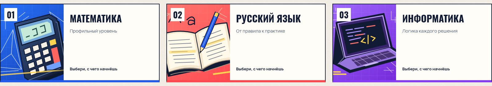
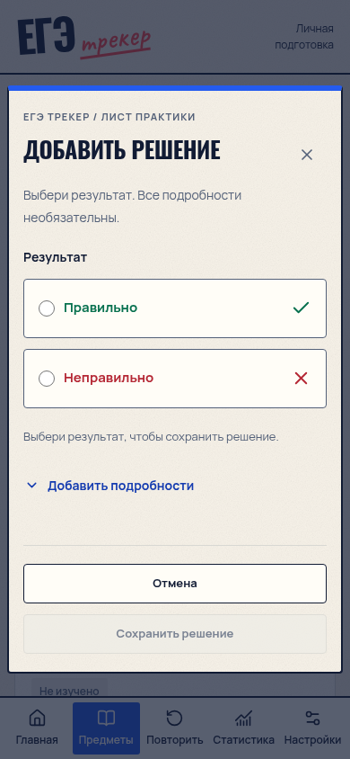

# ЕГЭ Трекер

[](https://vhronin.github.io/EGE-Tracker-Site/)

Личный трекер подготовки к ЕГЭ по **профильной математике, русскому языку и информатике**. Решайте задания из своих источников, записывайте результаты и возвращайтесь к темам, которым нужна практика.

<p align="center">
  <a href="https://vhronin.github.io/EGE-Tracker-Site/">
    
  </a>
</p>

<p align="center">
  <a href="https://vhronin.github.io/EGE-Tracker-Site/">Открыть сайт</a> ·
  <a href="docs/USER_GUIDE.md">Как пользоваться</a> ·
  <a href="#локальный-запуск">Запустить локально</a>
</p>

**Без регистрации · Данные в вашем браузере · Работа офлайн после подготовки кеша**

## Три предмета. Твоя траектория.



В каждом предмете — номера с готовыми названиями, необязательные подтемы и полная история решений. Состав и названия можно менять под свою подготовку.

## Практикуй. Анализируй. Развивайся.

| 01 / Записывайте                                                                           | 02 / Замечайте прогресс                                                                           | 03 / Возвращайтесь к важному                                                                        |
| ------------------------------------------------------------------------------------------ | ------------------------------------------------------------------------------------------------- | --------------------------------------------------------------------------------------------------- |
| Выберите номер и отметьте «Правильно» или «Неправильно». Подробности можно добавить позже. | Смотрите точность, объём практики и уровень освоения. Сравнивайте результаты за выбранный период. | Открывайте очередь повторения: она помогает выбрать, что потренировать дальше, и объясняет причину. |

- **История с подробностями.** Текст задания, свои и правильные ответы, комментарии и скриншоты — по желанию.
- **Быстрый ввод.** Можно сохранить отдельное решение или добавить сразу пачку результатов.
- **Свой порядок.** Поиск, фильтры, редактируемые номера и собственные подтемы.
- **Копии с изображениями.** Экспорт и импорт JSON для сохранения истории и переноса на другое устройство.
- **На компьютере и телефоне.** Адаптивный интерфейс и установка как PWA в поддерживаемых браузерах.

Оценка освоения помогает ориентироваться в подготовке и не является прогнозом балла ЕГЭ. Трекер учитывает вашу практику; банка задач в нём нет.

## Вот что ждёт внутри

[](https://vhronin.github.io/EGE-Tracker-Site/)

На скриншоте — новая база без решений. Показатели и история заполняются по мере вашей практики.

<details>
<summary><strong>Посмотреть, как выглядит запись решения на телефоне</strong></summary>

<p align="center">
  
</p>

Обязателен только результат. Подтему, текст, ответы, комментарий и скриншот можно добавить через «Добавить подробности».

</details>

## Первое решение — точка отсчёта

1. [Откройте трекер](https://vhronin.github.io/EGE-Tracker-Site/) и выберите предмет.
2. Откройте нужный номер и нажмите **«Добавить решение»**.
3. Выберите результат и сохраните запись.
4. Следите за статистикой и очередью повторения.
5. Регулярно сохраняйте резервную копию в настройках.

Подробнее — в [инструкции пользователя](docs/USER_GUIDE.md).

## Данные остаются у вас

История и скриншоты хранятся локально в IndexedDB текущего браузера. Приложение не отправляет их на сервер и не синхронизирует между устройствами автоматически.

**Сохраняйте JSON-копии:** очистка данных сайта может удалить историю. Другой адрес сайта, браузер или профиль браузера использует отдельное хранилище. Для переноса экспортируйте копию и импортируйте её там. Импорт проверяет файл и после подтверждения заменяет текущие данные; объединение копий не поддерживается.

Офлайн-режим становится доступен после первой загрузки и подготовки кеша; его готовность показана в настройках. Установка приложения зависит от браузера и устройства.

## Локальный запуск

Нужен **Node.js 22.12+**, рекомендуемая версия — **24**.

```sh
npm ci
npm run dev
```

Откройте адрес, который Vite выведет в терминале.

<details>
<summary><strong>Для разработчиков: сборка, проверки и архитектура</strong></summary>

**Стек:** React, TypeScript, Vite, Tailwind CSS, Dexie.js / IndexedDB, React Router и PWA. Серверная часть и внешняя база данных не требуются.

```sh
# Сборка и локальный просмотр production-версии
npm run build
npm run preview

# Типизация, линтер, форматирование, тесты и сборка
npm run check

# Браузерные проверки после сборки
npx playwright install chromium
npm run test:e2e

# Проверки размещения в подпапке GitHub Pages
npm run test:pages
```

Готовые файлы находятся в `dist/`. Service worker и офлайн-режим включены в production-сборке; для них нужен HTTPS или localhost.

Для GitHub Pages настроен процесс [Publish to GitHub Pages](.github/workflows/deploy-pages.yml): он проверяет и публикует проект при изменении основной ветки. Перед первой публикацией выберите **Settings → Pages → Source → GitHub Actions**. Подробнее — в [инструкции по публикации](GITHUB-PAGES.md).

- [Требования к приложению](PRD.md)
- [Архитектура и расчёт прогресса](ARCHITECTURE.md)
- [Структура данных](DATABASE.md)

</details>

---

**Маленькие шаги. Большие результаты.** Каждое решение считается.
